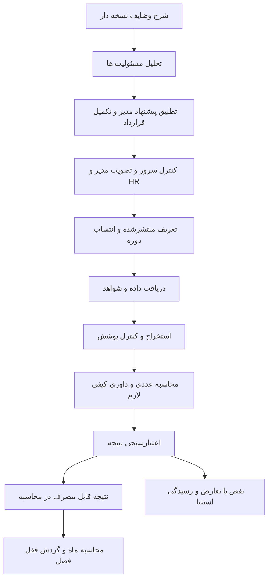

# پیشنهاد اجرایی نقش AI در پنل KPI

## اصلاح اجرایی جاری محلی: پایداری v4 — 2026-10-04

به درخواست کاربر، مرحله B هفت‌محوری با rubric ثابت، قفل سمت سرور برای retain تغییرنکرده، سابقه ایراد/اصلاح و کنترل مستقل پیشنهاد قبل از پذیرش پیاده شد. قفل فقط در زنجیره اصلاح همان شخص/ماه/مدیر و با شغل، سیاست، مدل، دستور و شاهد معتبر است؛ تغییر محتوای خود شاخص یا زمینه قفل را باطل می‌کند. تعارض بین‌شاخصی مستقل ثبت می‌شود. پس از چهار دور اصلاح (در بررسی پنجم) یا ناسازگاری کنترل کیفیت، به بازبینی مستند مدیر و HR ارجاع می‌شود؛ هیچ قفل تحلیلی به معنی تصویب یا پرداخت نیست. منبع داده/پوشش در B حذف می‌مانند و محاسبات مالی تغییر نکردند. قرارداد جاری `kpi-alignment-v4` و کنترل اصلاح `kpi-correction-validation-v1` است؛ بخش v3 پایین تاریخی است. جزئیات در قرارداد پرامپت و سند تحویل محلی آمده است.

نسخه پیشنهاد: ۱. تاریخ: 2026-10-04. وضعیت: پیشنهاد نهایی این بررسی برای پیاده‌سازی؛ هنوز اجرا یا به سیاست سازمان تبدیل نشده است.

اصلاح دامنهٔ اجرایی محلی به درخواست کاربر، 2026-10-04: در مرحله B نسخه v3، محورهای «منبع داده» و «پوشش» حذف و هفت محور دیگر حفظ شدند. این تغییر فقط غربال طراحی شاخص است؛ الزام قرارداد منبع/شاهد برای سنجش و پرداخت، کنترل مجوز، نسخه و تصویب سازمانی حذف نشده است. اصلاح قابل اعمالِ مستند و پذیرش همه اصلاحات در پیش‌نویس تازه اضافه شد؛ گزارش‌های v2 تاریخی می‌مانند. جزئیات جاری در بخش اصلاح v3 قرارداد پرامپت و سند تحویل محلی ثبت است؛ جداول گستردهٔ پایین، طراحی کل چرخه‌اند و به معنی فعال‌بودن همه مراحل نیستند.

پیشنهاد قطعی این بررسی، ساخت یک جریان کنترل‌شده برای تحلیل شرح وظایف، بررسی شاخص‌های مدیر و ارزیابی شواهد است. AI مسئول استخراج معنا، تطبیق، تشخیص ابهام و ارزیابی کیفیِ مبتنی بر معیار باشد. سرور مسئول اعتبارسنجی، محاسبه، اعمال مجوز، ثبت نسخه و انتقال وضعیت باشد. عملیات تکراری خودکار انجام شود؛ تصویب تعریف جدید، رفع تعارض و نهایی‌سازی سازمانی در گردش مجاز قرار گیرد.

این طرح جایگزین انتقال مستقیم پرامپت ۶٫۲ به پنل است. [نقد بندبه‌بند نمونه](AI_PROMPT_V62_REVIEW.md) و [پرامپت‌ها و قراردادهای پیاده‌سازی](AI_ROLE_PROMPT_CONTRACTS.md) جزء همین بسته‌اند. تغییر ضرایب مالی، آزمون‌سازی، داوری خودکار اعتراض، تحلیل Chat و تغییر قالب اکسل دامنه این مرحله نیستند.

## مرز اختیار و معنای تأیید

| تصمیم | مسئول پیشنهادی | اثر مجاز |
|---|---|---|
| استخراج مسئولیت و پیشنهاد شاخص یا اصلاح | AI | خروجی تحلیلی مستند، بدون بازنویسی شرح وظیفه یا شاخص اصلی |
| احراز ارتباط، سنجش‌پذیری و قابلیت ارزیابی | AI به همراه کنترل سرور | «قابل تأیید از نظر تحلیل» یا «نیازمند اصلاح/اطلاعات»؛ این وضعیت تصویب سازمانی نیست |
| تصویب نسخه جدید شرح وظیفه و شاخص | نقش‌های مجاز مدیر و HR در گردش فعلی | انتشار نسخه دارای تاریخ اثر و مالک پاسخ‌گو |
| شمارش، موعد، نرخ، وزن مؤثر مصوب، امتیاز و تجمیع | موتور قواعد | محاسبه بازتولیدپذیر از داده معتبر و قواعد منتشرشده |
| ارزیابی کیفیت یک خروجی | AI با rubric منتشرشده | انتخاب سطح تحقق با شاهد؛ امتیاز متناظر را کد می‌سازد |
| مصرف نتیجه در KPI | دروازه اعتبارسنجی سمت سرور | فقط نتیجه جاری، کامل، معتبر و واجد شرایط مصرف |
| استثنا، اختلاف ارزیاب یا اعتراض مؤثر بر نتیجه | مسئول مجاز | تصمیم دلیل‌دار و نسخه جدید؛ حفظ نتیجه قبلی |
| قفل فصل و خروجی مالی | گردش فعلی مدیر و HR و کنترل‌های مصوب | نتیجه سازمانی قطعی؛ مدل اختیار تغییر سیاست یا پرداخت ندارد |

این تقسیم کار با هدف کاهش دخالت انسانی سازگار است: پس از تصویب تعریف و معیارها، دریافت داده، استخراج، ارزیابی، محاسبه و اطلاع‌رسانی به‌صورت خودکار انجام می‌شوند. تعریف تغییرنکرده در هر ماه دوباره طراحی و تصویب نمی‌شود؛ استفاده مجدد فقط در بازه اعتبار همان نسخه و با انتساب معتبر مجاز است. در نسخه فعلی طرح‌ها ماهانه‌اند؛ افزودن استفاده مجدد نیازمند مدل داده انتساب دوره است و نباید فرض شود اکنون وجود دارد.

اگر سازمان بعداً انتشار خودکار برخی تعریف‌ها را بخواهد، باید دامنه تفویض اختیار، قالب‌های ازپیش‌مصوب و شرایط استثنا را تصویب کند. نام «تأیید AI» به‌تنهایی چنین اختیاری ایجاد نمی‌کند. در این پیشنهاد، تعریف جدید همان تأیید مدیر و HR را حفظ می‌کند.

## مرحله اول تحلیل شرح وظایف

محرک، ثبت یا تغییر نسخه شرح وظیفه و درخواست تحلیل مجاز است. تحلیل پیش‌نویس می‌تواند برای اصلاح متن انجام شود؛ انتشار KPI فقط به نسخه منتشرشده معتبر متصل می‌شود.

ورودی شامل عنوان و سطح شغل، واحد و نقش سازمانی، بندهای شماره‌دار شرح وظیفه، بازه اثر، مستندات فرایند و حدود اختیار مجاز است. نام، شماره تماس، حقوق، مکالمه شخصی و امتیاز گذشته فرد برای این تحلیل لازم نیست. شناسه داخلی مستعار برای اتصال رکورد کافی است.

AI برای هر مسئولیت این موارد را استخراج می‌کند:

- فعالیت و خروجی مورد انتظار، دریافت‌کننده خروجی و نقش فرد در تهیه، کنترل، پیگیری یا تصمیم.
- تناوب، موعد، حجم، وابستگی به دیگران و منابع موردنیاز؛ اگر در منبع نیستند، مقدار نامعلوم ثبت می‌شود.
- نوع کار روتین، پروژه‌ای یا رویدادمحور؛ موارد چندگانه یا مبهم علامت می‌خورند.
- حدود کنترل فرد، ریسک خطا، الزامات کیفیت و امکان تهیه شاهد.
- ارجاع به بند و عبارت دقیق منبع برای ادعاهای استخراج‌شده.
- ابهام‌ها، وظایف تکراری، مسئولیت مشترک و تعارض شرح وظیفه با فرایند واقعی.

خروجی یک «نقشه مسئولیت‌ها» است. این نقشه متن رسمی شرح وظیفه را تغییر نمی‌دهد. موارد استنباطی با عنوان پیشنهاد نمایش داده می‌شوند؛ خروجی AI نباید مسئولیت تازه‌ای را به‌عنوان وظیفه رسمی فرد جا بزند. شرح ناقص ابتدا تکمیل می‌شود و نقش پیچیده به دلیل سختی سنجش حذف نمی‌شود.

برای تغییر سمت، سیستم تفاوت دو نسخه را می‌سازد و AI اثر معنایی تغییر را بر شاخص‌های متصل توضیح می‌دهد. شاخص‌های واقعاً بی‌اثر تا پایان اعتبار خود باقی می‌مانند؛ شاخص‌های متأثر برای بازنگری علامت می‌خورند. بازه گذشته با نسخه خودش محاسبه می‌شود. برای انتقال میان‌ماه، دوره باید به بازه‌های انتساب تقسیم شود؛ اگر این قابلیت هنوز آماده نیست، محاسبه آن مورد متوقف و به استثنا ارجاع شود، نه اینکه کل ماه به سمت جدید نسبت داده شود.

## مرحله دوم بررسی پیشنهاد مدیر و تکمیل شاخص

تحلیل اولیه مسئولیت‌ها پیش از نمایش پیشنهاد مدیر به مدل تهیه یا از کش معتبر خوانده شود. سپس پیشنهاد مدیر همراه همان نقشه بررسی شود. این کار برای کاهش جهت‌دهی ناشی از پیشنهاد اولیه است؛ برتری خودکار پیشنهاد مدل بر شناخت مدیر فرض نمی‌شود.

برای هر پیشنهاد، AI باید دقیقاً یک توصیه اصلی بدهد: حفظ، اصلاح، ادغام پیشنهادی، جایگزینی پیشنهادی، رد تحلیلی یا نیازمند اطلاعات. توصیه شامل دلیل، وظایف مرتبط، شواهد، موارد نقص و تغییر پیشنهادی است. هیچ پیشنهاد مدیر بی‌پاسخ نمی‌ماند و هیچ پیشنهاد حذف‌شده‌ای از سابقه پاک نمی‌شود.

| محور بررسی | سؤال لازم |
|---|---|
| ارتباط با شغل | کدام بند وظیفه و کدام خروجی را می‌سنجد؟ |
| کنترل‌پذیری | فرد بر نتیجه چه اختیاری دارد و کدام وابستگی‌ها خارج از اختیار اوست؟ |
| اعتبار سنجش | این معیار خود نتیجه را اندازه می‌گیرد یا فقط جانشین ضعیفی مانند تعداد فایل تولیدشده است؟ |
| تعریف | نوع شاخص، جامعه، واحد، جهت، دوره، صورت و مخرج در صورت نیاز روشن‌اند؟ |
| هدف | مقدار هدف چه مرجع معتبر و تاریخ اثری دارد و با ظرفیت و تعهد شغل سازگار است؟ |
| شواهد | داده کجا تولید می‌شود، مالک آن کیست و چه چیزی اجرای واقعی را اثبات می‌کند؟ |
| هم‌پوشانی | کدام نتیجه با چه منطق تجمیعی دوباره پاداش می‌گیرد؟ |
| رفتار ناخواسته | افزایش تعداد، تأخیر ثبت، خردکردن کار یا انتخاب گزینشی موارد می‌تواند نمره را مصنوعی بهتر کند؟ |
| پوشش | کدام مسئولیت مهم فاقد سنجش مانده و چرا؟ |
| امکان ارزیابی خودکار | کدام بخش محاسبه قطعی دارد و کدام بخش داوری معنایی لازم دارد؟ |

کامل‌بودن اطلاعات شرط انتشار است؛ نبود اطلاعات مساوی رد ماهوی نیست. اگر پیشنهاد از اساس خارج از نقش است، رد تحلیلی با دلیل مناسب است. اگر ارتباط روشن و منبع داده نامعلوم است، وضعیت نیازمند اطلاعات مناسب‌تر است.

AI برای مسئولیت‌های مهمِ بدون پوشش، کاندید ارائه می‌کند. هر کاندید منشأ و کمبودهای مشخص دارد؛ منبع، تارگت یا فرمول اختصاصی اختراع نمی‌شود. سقف پنج شاخص از فایل نمونه منتقل نمی‌شود. پوشش مناسب، پرهیز از تکرار و هزینه سنجش مبنای انتخاب‌اند؛ شاخص پایش توسعه‌ای می‌تواند ثبت شود ولی بدون قرارداد کامل وارد امتیاز جبرانی نشود.

وزن نسبی ۱ تا ۵ فعلی پنل حفظ می‌شود. AI می‌تواند ناسازگاری یا پیشنهاد وزن را گزارش کند؛ تغییر فقط با تصمیم مجاز و ثبت دلیل انجام می‌شود. نرمال‌سازی وزن تسک‌ها داخل روتین و داخل پروژه انجام می‌شود و با درصد مؤلفه‌ها در مدل واحد متفاوت است. کیفیت داده دروازه قابلیت سنجش است، نه ضریب خودکار ارزش شغل.

## مرحله سوم قرارداد شاخص و شواهد

خروجی دو مرحله قبل تا تکمیل و تصویب این قرارداد، شاخص قابل محاسبه نیست. برای کاهش ورود دستی، فیلدهای معلوم از داده موجود پر می‌شوند و فقط کمبودهای مؤثر، یکجا با مسئول پاسخ‌گویی نمایش داده می‌شوند.

| گروه اطلاعات | فیلدهای الزامی |
|---|---|
| هویت و اعتبار | شناسه پایدار، نسخه، وظایف مرتبط، نقش/سمت، بازه اثر، دوره یا قاعده انتساب، تصویب‌کنندگان |
| تعریف عملکرد | عنوان، خروجی، نوع روتین/پروژه/رویداد، نوع سنجش، واحد، جهت، تناوب، فرصت انجام و موعد |
| هدف و وزن | هدف و منبع/نسخه آن، وزن نسبی، مؤلفه مقصد، قواعد نمونه کم یا جامعه بدون مورد |
| قرارداد داده | منبع و مالک، فیلدها، سطح رکورد، کلید یکتا، شناسه انتساب، بازه زمانی، قواعد اتصال و حذف تکرار |
| کامل‌بودن داده | مرجع جامعه مورد انتظار، مهلت ورود، نشان تکمیل منبع، کنترل تازگی، قاعده قطعی/اصلاح داده |
| قرارداد شاهد | نوع شاهد پذیرفته، شیوه اثبات انتساب و زمان، آدرس صفحه/سلول/رکورد، داده لازم برای هر معیار |
| نمره‌دهی | شناسه فرمول مجاز یا rubric مصوب، نسخه، سطوح توصیفی، وزن معیارها و معیارهای الزامی |
| استثنا | نبود رخداد، مرخصی/انتقال/توقف سامانه طبق سیاست، مخرج صفر، تأخیر خارج از اختیار و مسئول تعیین تکلیف |
| ردیابی | نسخه تحلیل و ارجاعات، هش تعریف، سابقه اصلاح، رابطه با نسخه قبلی و دلیل تصمیم نهایی |

برای شاخص عددی، فرمول از فهرست مجاز انتخاب می‌شود؛ مدل نباید کد یا عبارت اجرایی دلخواه تولید کند. برای شاخص کیفی، rubric قبل از مشاهده نتیجه دوره تصویب می‌شود. سطوح باید معنای قابل مشاهده داشته باشند؛ مثلاً «هیچ بخش الزامی تکمیل نیست»، «بخشی تکمیل است»، «همه بخش‌های الزامی تکمیل است». تعداد سطوح و امتیاز متناظر برای همان شاخص تعریف می‌شود؛ مقیاس عمومی بدون تعریف به همه مشاغل تحمیل نشود.

معیار الزامی که نبودش پذیرش کل خروجی را نامعتبر می‌کند باید صریح باشد. اثر آن بر امتیاز، سقف یا وضعیت نیز پیشاپیش تعریف شود؛ مدل اجازه ندارد پس از دیدن خروجی جریمه یا دروازه جدید بسازد.

پروژه با milestoneهای ازپیش‌وزن‌دار سنجیده شود؛ تقسیم کار به مراحل کوچک نباید امتیاز اضافه ایجاد کند. کیفیت یک تحویل و درصد پیشرفت پروژه جدا محاسبه می‌شوند و قاعده اتصال آن‌ها باید قبل از دوره مشخص باشد.

## مرحله چهارم ارزیابی شواهد فعالیت

محرک، تکمیل بسته شواهد یک رخداد/فعالیت یا رسیدن زمان دریافت داده منبع است. بارگذاری فایل پیش‌نویس فقط استخراج و کنترل اولیه را فعال می‌کند. اگر برای تکمیل بسته علامت معتبر وجود ندارد، سیستم نتیجه موقت نشان می‌دهد تا بسته بسته شود؛ این کار از ارزیابی چندباره و نمره‌دهی زودهنگام جلوگیری می‌کند.

ترتیب اجرا:

1. سرور هویت، انتساب فعالیت، دوره و قرارداد منتشرشده را کنترل و snapshot می‌سازد.
2. فایل خام حفظ می‌شود؛ استخراج متن/داده یا خوانش دیداری مجاز با نسخه و آدرس منبع ثبت می‌شود.
3. پوشش منبع، پوشش استخراج و پوشش هر معیار جدا کنترل می‌شوند. ظاهر فایل یا ادعای نویسنده اثبات کامل‌بودن منبع نیست.
4. سنجش عددی و موعد از داده ساختاریافته با کد اجرا می‌شود. AI فقط برای بخش نیازمند فهم متن/تصویر فراخوانی می‌شود.
5. مدل برای هر معیار، تحقق، عدم تحقق مستند، تحقق جزئیِ مجاز در rubric، شواهد ناکافی یا تعارض شواهد را همراه ارجاع و سطح rubric گزارش می‌کند.
6. سرور شناسه‌ها، ارجاعات، سازگاری سطح و وضعیت، دامنه داده و پوشش را کنترل می‌کند و امتیاز را از قرارداد منتشرشده می‌سازد.
7. نتیجه معتبر طبق سیاست مصرف وارد محاسبه می‌شود؛ نقص یا تعارض به صف مورد استثنا می‌رود. تغییر شاهد نتیجه قبلی را تاریخی و نتیجه جاری را نیازمند ارزیابی می‌کند.
8. پرسنل دلیل و اقدام لازم را می‌بیند؛ مدیر وضعیت تیم و مسائل مؤثر را می‌بیند؛ لاگ فنی و کنترل نسخه برای HR در دسترس است.

برای rubric، AI عدد آزاد صفر تا صد تولید نمی‌کند؛ شناسه سطح را انتخاب می‌کند و کد امتیاز و تجمیع را انجام می‌دهد. برای داده‌ای که از سند استخراج می‌شود، مدل مقدار پیشنهادی و محل آن را می‌دهد؛ نوع، واحد و صحت استخراج باید کنترل شود. آمار کل فایل بزرگ از خلاصه چند سلولی استخراج نمی‌شود.

برای معیارهای کیفی، تغییر نام فرد، سبک نگارش، طول متن یا ادبیات دفاعی نباید نمره را عوض کند مگر همان ویژگی معیار مصوب خروجی باشد. زیبایی گزارش معادل اجرای واقعی نیست و هش فایل فقط هویت فایل را اثبات می‌کند، نه اصالت عملکرد.

### وضعیت داده و اثر مجاز

| وضعیت | امتیاز و اقدام |
|---|---|
| منبع و شاهد کافی | اجرای فرمول یا rubric مصوب |
| نقص شواهد معیار | نمره آن معیار نامعلوم؛ نتیجه کل غیرنهایی مگر قرارداد مصوب صریحاً مصرف جزئی را مجاز کرده باشد |
| خرابی/نبود منبع | انتظار یا استثنا؛ بدون صفرکردن نمره یا وزن |
| شواهد متعارض | ارجاع مستند برای رفع تعارض؛ میانگین‌گیری دلخواه ممنوع |
| رخداد مورد انتظار با عدم انجامِ اثبات‌شده | عدم تحقق طبق قرارداد؛ مثال صفر فقط با منبع کامل، انتساب و مهلت معتبر |
| جامعه واقعاً بدون مورد واجد شرایط | وضعیت فاقد مصداق؛ اعمال فقط سیاست ازپیش‌مصوب؛ پیش‌فرض انتظار تعیین تکلیف |
| خطای مدل یا تبدیل | خطای فنی؛ بدون اثر عملکردی؛ تلاش دوباره محدود |
| شرح وظیفه یا قرارداد تغییرکرده | نتیجه قدیمی؛ ارزیابی نسخه مناسب برای بازه اثر |

قاعده خاص فعلی «فرد بدون پروژه با سهم ثابت، نمره پروژه صفر» یک تصمیم موجود پروژه است و در این بسته تغییر نمی‌کند. این قاعده به نبود داده سایر شاخص‌ها تعمیم داده نمی‌شود. پیامد عدالت آن، به‌خصوص وقتی تخصیص پروژه در اختیار فرد نیست، همچنان تصمیم سیاستی باز است.

### کیفیت و کمیت باید جدا سنجیده شوند

مثال فرضی: هدف مصوب، تحویل ۱۰ گزارش در ماه است. هشت گزارش معتبر تحویل شده و منبع کامل، نبود دو گزارش را اثبات می‌کند. تحقق تعداد ۸۰٪ است. ارزیابی کیفیت همان هشت گزارش از rubric جدا به دست می‌آید. اگر فرمول مصوب کیفیت و کمیت را ترکیب می‌کند، یک بار و با وزن‌های همان فرمول انجام می‌شود؛ «پوشش ۸۰٪» دوباره به‌عنوان جریمه داده اعمال نمی‌شود.

اگر در همین مثال سامانه فقط اطلاعات هشت گزارش را برگردانده و کامل‌بودن منبع معلوم نیست، نتیجه تحقق ۸۰٪ قطعی نیست. AI باید درخواست تکمیل منبع بدهد، نه اینکه دو گزارش را انجام‌نشده اعلام کند.

### نمونه کامل تطبیق و ارزیابی

شرح وظیفه فرضی: «بررسی کامل‌بودن درخواست خرید و ارجاع درخواست کامل به تأمین در یک روز کاری». پیشنهاد مدیر: «درصد خریدهایی که تأمین‌کننده به‌موقع تحویل می‌دهد». AI وابستگی به تأمین‌کننده و خارج‌بودن نتیجه نهایی از اختیار کارشناس بررسی را گزارش می‌کند و شاخص «درصد درخواست‌های کامل بررسی و ارجاع‌شده در مهلت مصوب» را پیشنهاد می‌دهد.

اگر SLA یک روز کاری، منبع ثبت زمان و مرجع درخواست کامل موجود باشند، صورت برابر ارجاع‌های واجد شرایط در مهلت و مخرج برابر کل درخواست‌های کاملِ منتسبِ سررسیدشده است. هدف باید از SLA یا مصوبه معتبر خوانده شود؛ AI هدف ۹۵٪ را حدس نمی‌زند. اگر هدف مصوب فرضی ۹۵٪ و داده کامل شامل ۲۰ مورد با ۱۸ تحویل به‌موقع باشد، نرخ ۹۰٪ و در الگوی بیشتر بهتر نمره `min(100, 90 / 95 × 100)` یعنی حدود ۹۴٫۷۴ است. این عدد با کد ساخته می‌شود. AI فقط برای تفسیر کامل‌بودن مدارک، در صورت وجود rubric مربوط، کمک می‌کند.

## تجربه کاربری در همین پنل

| محل موجود | تغییر پیشنهادی |
|---|---|
| شرح وظایف HR | جزئیات تحلیل شامل مسئولیت‌ها، خروجی‌ها، ابهام و ارجاع متن؛ اصل صفحه خواندنی باقی می‌ماند و اصلاح از گردش رسمی سمت انجام می‌شود |
| تعریف تسک مدیر | پنل تطبیق کنار پیشنهاد؛ متن اصلی، دلیل، نقص‌ها و نسخه پیشنهادی کنار هم؛ پذیرش پیشنهاد یک اقدام صریح و نسخه‌دار |
| درخواست‌های ورودی HR | خلاصه پوشش وظایف، اختلاف مدیر و AI، تکمیل قرارداد و موانع انتشار؛ تأیید فنی از تصویب سازمانی قابل تشخیص |
| کارتابل روتین و پروژه پرسنل | معیار و شاهد لازم پیش از ارسال؛ بعد از ارزیابی، شاهد استفاده‌شده، دلیل، وضعیت موقت/قطعی و اقدام لازم |
| تیم مدیر | موارد ناقص و متعارض با مسئول رفع و موعد؛ تغییر دستی نمره بدون دلیل و نسخه مجاز نباشد |
| AI ادمین | همان لاگ فعلی توسعه یابد: مراحل وظیفه، تطبیق، پیش‌پردازش، شواهد، نتیجه اعتبارسنجی و وضعیت مصرف در KPI |
| تنظیمات مدل محاسبه | سیاست‌های محاسباتی مصوب؛ تنظیم ارائه‌دهنده و عملیات AI در بخش مجاز جدا، بدون مخلوط‌شدن با درصدهای مدل |

برای هر پیشنهاد نمایش «چرا»، «مبنای کدام بند» و «چه چیزی کم است» ضروری است. نمایش درصد اطمینان مدل به‌عنوان احتمال صحت حذف شود؛ اطمینان خوداظهاری مدل معیار انتشار نیست. نام‌های داخلی وضعیت و هش‌ها در رابط روزمره نمایش داده نشوند، ولی برای ممیزی قابل بازیابی باشند.

## معماری و اتصال به کد موجود

این مراحل سرویس‌های منطقی در بک‌اند موجودند؛ به چند عامل خودمختار، چند سرویس شبکه‌ای یا بازنویسی کامل سامانه نیاز ندارند. ترتیب اجرای ابزارها و دسترسی‌ها را برنامه مدیریت می‌کند.

| فایل یا بخش موجود | اقدام پیاده‌سازی |
|---|---|
| `backend/organization-workflow.mjs` | توسعه `analyzeDesign`؛ ارجاعات و نقشه مسئولیت؛ کنترل نسخه/هش در پایان درخواست و پیش از هر تصویب؛ حفظ مسیر مدیر و HR |
| `backend/task-definition.mjs` | قرارداد نوع شاخص، منبع/هدف، rubric و شناسه فرمول؛ اعتبارسنجی دامنه و استثنا؛ حفظ سازگاری تعریف‌های قبلی |
| فایل‌های جدید تحلیل و قرارداد در `backend` | جداسازی تحلیل وظیفه، تطبیق، schema و کنترل نتیجه از فایل بزرگ گردش سازمان |
| `backend/evaluation.mjs` | جایگزینی نمره آزاد با سطح rubric؛ تفکیک نتیجه عددی و کیفی؛ ارجاعات ترکیبی سند/استخراج/بخش؛ کنترل پوشش هر معیار |
| `backend/extract.mjs` و هارنس‌های فعلی | حفظ خام، آدرس شاهد، manifest پوشش؛ پردازش بخش‌بندی‌شده برای فایل بزرگ؛ OCR همچنان وابسته به اتصال مجاز |
| `backend/personnel-workflow.mjs` | تغییر پل `activityScore` به خواندن نتیجه پذیرفته‌شده با نسخه معتبر؛ میانگین کیفیت عمومی به‌طور ضمنی نمره کل KPI نباشد |
| `src/performance-model.js` | مصرف امتیاز معتبر؛ سیاست مالی و درصدهای موجود بدون تغییر در این دامنه |
| `server.mjs` | مسیر تحلیل شرح وظیفه، وضعیت اجرا، بسته شواهد و صف؛ شناسه اجرای یکتا، کنترل مجوز و ابطال پاسخ قدیمی |
| `backend/store.mjs` و `backend/ai-log.mjs` | انواع رکورد و projection جدید، ارتباط اجرا با تصمیم مصرف و نسخه؛ حداقل داده در خروجی هر نقش |
| `src/lifecycle-ui.js` و `src/ai-ui.js` و `src/ai-log-ui.js` | نمایش نتیجه و نقص با زبان ساده، تفاوت پیشنهادی، وضعیت نهایی و پاک‌سازی هنگام تغییر حساب |

### رکوردهای پیشنهادی

- `job-analysis`: snapshot شرح وظیفه، نسخه/هش، مسئولیت‌های مستند، ابهام‌ها و اجرا.
- `metric-definition`: شناسه منطقی پایدار، نسخه قرارداد کامل، تاریخ اثر، وضعیت و تصویب‌ها.
- `metric-assignment`: اتصال نسخه شاخص به فرد/بازه/دوره، وزن و رخدادهای مورد انتظار؛ از ساخت تعریف تکراری در هر ماه جلوگیری می‌کند.
- `evidence-package`: شناسه بسته، فعالیت و رخداد، نسخه شواهد، manifest منبع/استخراج، وضعیت تکمیل و هش‌ها.
- `criterion-result`: نتیجه هر معیار و ارجاعات، سطح rubric، facts معتبر و نسخه مبنا.
- `metric-assessment`: محاسبه امتیاز، وضعیت قابلیت مصرف، نوع پذیرش و موانع؛ به اجرای AI و قرارداد پیوند دارد.
- `ai-run`: نوع مرحله، ارائه‌دهنده/مدل، نسخه پرامپت/schema، ورودی snapshot، خروجی، زمان، مصرف گزارش‌شده و خطای عمومی.
- `exception-case`: نقص/تعارض، مسئول، موعد، تصمیم، دلیل و پیوند اصلاح نسخه.

این نام‌ها قرارداد پیشنهادی‌اند، نه جداول یا APIهای موجود. از الگوی ذخیره فعلی استفاده شود؛ مهاجرت داده بدون بازنویسی نتیجه‌های تاریخی انجام شود.

### وضعیت و هم‌زمانی

وضعیت اجرای AI (`queued/running/succeeded/failed`) از وضعیت تعریف (`draft/needs_information/needs_revision/manager_review/hr_review/published`) و وضعیت مصرف نتیجه (`pending/eligible/needs_review/stale`) جدا باشد. مدل هیچ‌یک از وضعیت‌های انتشار یا مصرف را مستقیماً تغییر نمی‌دهد.

کلید کش شامل نوع مرحله، هش داده مرتبط، نسخه شرح وظیفه/تعریف، سیاست، rubric، استخراج، پرامپت، schema و ارائه‌دهنده/مدل است. شناسه وظیفه و شاخص را سرور تولید می‌کند. نتیجه یکسانِ ثبت‌شده بازیابی می‌شود؛ اجرای مجدد مدل الزاماً همان قضاوت را تولید نمی‌کند. محاسبه عددی روی facts و سطوح ثبت‌شده باید دقیقاً بازتولیدپذیر باشد.

پاسخ دیررس مدل اگر نسخه مبنا، رابطه سازمانی یا مجوز تغییر کرده باشد، فقط به‌عنوان اجرای تاریخی ذخیره می‌شود و روی وضعیت جاری اعمال نمی‌شود. اعمال نتیجه و تغییر وضعیت در تراکنش با کنترل نسخه انجام شود. قفل اجرای تکراری و کلید یکتایی، جلوگیری از مصرف دوگانه را در سرور تضمین کنند.

برای اجرای عادی، صف پایدار با retry محدود و زمان‌بندی پله‌ای لازم است؛ خطای دائمی یا تمام‌شدن بودجه به صف استثنا می‌رود. تغییر مدل یا fallback نباید پنهان باشد. شکست AI ذخیره پیش‌نویس و دریافت شواهد را متوقف نکند، اما نتیجه لازمِ نامعتبر مصرف نشود.

## خودکارسازی قابل اتکا و ارزیابی پیش از فعال‌سازی

در فاز نخست، تحلیل و ارزیابی جدید در حالت آزمایشی موازی اجرا شود و نتیجه جدید به محاسبات جاری وصل نشود. این پیشنهاد مستلزم feature flag و مسیر امتیاز مستقل است؛ کد فعلی چنین جدایی کاملی ندارد. پس از آزمون، مصرف نتیجه برای هر نوع معیار جدا فعال شود.

شاخص عددی با منبع معتبر و قواعد قطعی می‌تواند پس از کنترل سیستمی خودکار مصرف شود. مصرف خودکار قضاوت کیفی فقط برای خانواده معیارهایی فعال شود که در مجموعه ارزیابی نماینده قابل قبول بوده‌اند. خانواده ارزیابی‌نشده، تعارض یا فقدان شاهد نیازمند بررسی است. آستانه اعتماد از عدد خوداظهاری مدل ساخته نمی‌شود.

مجموعه ارزیابی شامل نمونه‌های واقعیِ مجاز یا ساختگی واقع‌نما از چند واحد، چند سطح شغل، انواع فایل و وضعیت‌های دشوار باشد. پاسخ مرجع را کارشناسان مرتبط تعیین و اختلاف‌هایشان را ثبت کنند. از مجموعه توسعه و آزمون نگه‌داشته‌شده جدا استفاده شود. داده ساختگی به‌تنهایی اثبات آمادگی سازمانی نیست.

معیارها: دقت تطبیق وظیفه، پوشش مسئولیت‌های مهم، نرخ پذیرش نادرست شاخص، تشخیص کمبود اطلاعات، اعتبار ارجاع، توافق سطح rubric با مرجع، پذیرش نادرست شواهد، پایداری در تغییرهای بی‌اثر، هزینه و زمان اجرا. نتایج به تفکیک واحد/خانواده معیار و با اندازه نمونه و عدم‌قطعیت گزارش شوند. حدود عددی مجاز پس از مشاهده داده پایلوت و قبل از فعال‌سازی ثبت شوند؛ عدد دقت دلخواه به‌عنوان استاندارد معرفی نشود.

کنترل‌های سخت با تحمل صفر در تست: دسترسی غیرمجاز، نشت حقوق یا Chat، اجرای دستور داخل مستند، قبول شناسه/ارجاع جعلی، اعمال پاسخ نسخه قدیمی، تغییر خودکار وزن به دلیل داده مفقود، تغییر نتیجه قفل‌شده و انتشار بدون مجوز. صفر خطا در تست، ادعای صفر خطا در دنیای واقعی نیست.

پس از انتشار، نرخ خطا، اعتراض پذیرفته‌شده، اختلاف مدل و مرجع، تغییر ترکیب فایل‌ها و تغییر نسخه مدل پایش شود. ارزیابی کیفیت دوره‌ای برای کنترل سامانه است و ممیزی دستی تک‌تک فعالیت‌های عادی نیست. مسیر اعتراض موجود حفظ شود؛ بازنگری نتیجه قفل‌شده نیازمند اصلاحیه نسخه‌دار است.

## ترتیب ساخت و معیار پایان

| گام | خروجی قابل تحویل | معیار پایان |
|---|---|---|
| ۱ | قرارداد داده، نسخه‌ها و تحلیل شرح وظیفه | استخراج مستند، مقدار نامعلوم صریح، تغییر نسخه و دسترسی درست |
| ۲ | تطبیق پیشنهاد مدیر و شناسنامه شاخص | هر پیشنهاد یک نتیجه؛ پوشش وظایف؛ هدف/منبع/rubric کامل؛ نشر فقط با گردش مجاز |
| ۳ | بسته شواهد و ارزیابی جدید | جدایی عدد و کیفیت؛ ارجاعات معتبر؛ نقص/تعارض بدون امتیاز قطعی؛ صف و retry |
| ۴ | پل امتیاز و اجرای موازی | نتیجه جدید از مسیر قدیمی مستقل؛ مقایسه با مرجع؛ محاسبه قطعی و حفظ گذشته |
| ۵ | فعال‌سازی محدود و پایش | مجوز داده و اتصال آزموده، هویت سازمانی متناسب، کیفیت پذیرفته‌شده و امکان بازگشت |

تست‌های لازم: شرح مبهم؛ KPI خارج از اختیار؛ هدف بی‌مرجع؛ هم‌پوشانی واقعی و ظاهری؛ بیش از پنج شاخص معتبر؛ تغییر سمت میان‌دوره؛ عدم دسترسی مدیر سابق؛ منبع قطع؛ جامعه بدون مورد؛ عدم انجامِ اثبات‌شده؛ داده جزئی؛ OCR مبهم؛ نقل‌قول جعلی یا درست با استدلال غلط؛ milestone با وزن متفاوت؛ تجمیع کیفیت و تعداد؛ prompt injection؛ تغییر نام فرد؛ پاسخ دیررس؛ retry و رخداد تکراری؛ تغییر سیاست/مدل؛ بازسازی محاسبه و حفظ snapshot فصل.

تست نحوی و همه تست‌های مرتبط موجود باید بعد از پیاده‌سازی اجرا شوند. صرف عبور از تست ساختاری، اعتبار قضاوت مدل را اثبات نمی‌کند. تست مدل واقعی جدا، با داده مجاز و گزارش مدل/هزینه/نتیجه انجام می‌شود.

## تصمیم‌هایی که برای طراحی حل شده و داده‌هایی که هنوز لازم‌اند

پیشنهاد این بررسی درباره معماری، عدم انتقال قواعد مالی نمونه، حفظ وزن هنگام نقص داده، استفاده از rubric، مرز انتشار و اتصال معتبر امتیاز مشخص است. برای شروع توسعه نمونه محلی نیازی به بازکردن دوباره این تصمیم‌های فنی نیست.

برای بهره‌برداری سازمانی باید منابع واقعی و مالک هر منبع، تقویم و شیفت، قواعد مرخصی/انتقال، اهداف/SLA مصوب، rubricهای شغلی، سیاست فاقد مصداق، حدود مصرف خودکار نتیجه کیفی و ارائه‌دهنده مجاز داده تعیین شوند. AI می‌تواند تهیه این اطلاعات را تسهیل کند؛ مجاز نیست مقادیر مجهول را بسازد. تا تعیین آن‌ها، پیش‌نویس و اجرای آزمایشی ممکن است ولی انتشار تعریف ناقص یا مصرف نتیجه نامعتبر متوقف می‌ماند.

منابع و تفکیک استنتاج‌های پروژه از توصیه حرفه‌ای در [گزارش نقد](AI_PROMPT_V62_REVIEW.md) ثبت شده‌اند. مبنای تناسب معیار با نوع شغل و اعتبار سنجش، [راهنمای CIPD](https://www.cipd.org/en/knowledge/factsheets/performance-factsheet/) است؛ آزمون و کنترل خطاهای AI با جهت‌گیری [NIST AI RMF](https://www.nist.gov/itl/ai-risk-management-framework) سازگار است. هیچ‌یک از این منابع فرمول یا گردش اختصاصی این پیشنهاد را الزام نکرده‌اند.
