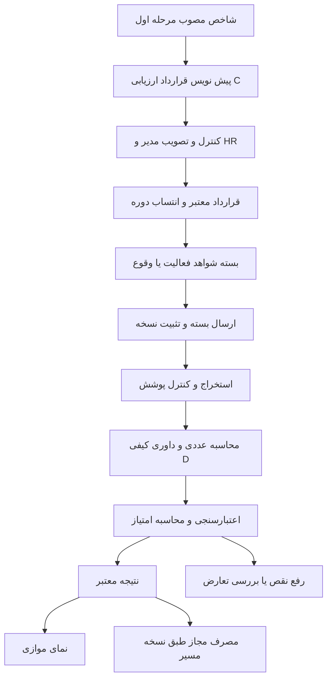

# مشخصات اجرایی مرحله دوم ارزیابی شواهد

نسخه ۱ — 2026-10-06. دامنه: قرارداد ارزیابی C، داوری شواهد D و پل کنترل‌شده نتیجه به محاسبه در نسخه محلی پنل.

## هدف و معیار موفقیت

هر نمره باید به یک فعالیت منتسب، قرارداد منتشرشده، نسخه شواهد، معیار روشن و محاسبه قابل بازسازی برگردد. پرسنل باید بداند چه چیزی پذیرفته نشده و چه شاهدی لازم است. مدیر باید فقط موارد استثنا و تعریف‌های جدید را تعیین تکلیف کند؛ عملیات تکراری پس از اعتبارسنجی قابلیت خودکارشدن داشته باشد.

موفقیت برابر پاسخ‌دادن مدل نیست. موفقیت یعنی ارجاع معتبر، قضاوت منطبق با معیار، محاسبه صحیح، استفاده از سیاست درست، جلوگیری از نتیجه قدیمی و حفظ سابقه. این تفکیک با تأکید [CIPD بر اعتبار و پایایی سنجش](https://www.cipd.org/en/knowledge/factsheets/performance-factsheet/) سازگار است. کنترل پاسخ ساختگی و اتکای بیش‌ازحد به مدل با مخاطرات شرح‌داده‌شده در [پروفایل AI مولد NIST](https://nvlpubs.nist.gov/nistpubs/ai/NIST.AI.600-1.pdf) ارتباط دارد؛ انتخاب معماری و حدود اجرایی پایین تصمیم طراحی همین پروژه است.

## یافته های مبنای کد در این بررسی

| بخش موجود | واقعیت و پیامد برای ساخت |
|---|---|
| `backend/job-design-analysis.mjs` | A مستقل، B هفت‌محوری `kpi-alignment-v4` و کنترل اصلاح موجودند؛ این کار آن‌ها را از نو نمی‌سازد |
| `docs/AI_ROLE_STAGE_AB_LOCAL.md` | C و D جدید هنوز تحویل نشده‌اند؛ بخش‌های v2/v3 قدیمی در این سند سابقه‌اند |
| `backend/evaluation.mjs` | معیارها متن‌اند؛ مدل برای هر معیار نمره آزاد ۰ تا ۱۰۰ می‌دهد؛ میانگین ساده گرد می‌شود؛ حذف chunk یا استخراج ناقص نتیجه کل را ناکافی می‌کند |
| `backend/score-rules.mjs` | قانون با دامنه واحد/نوع و زمان مؤثر انتخاب می‌شود؛ کسر زمانی و قواعد اصلاح از ارزیابی معنایی جدا هستند |
| `server.mjs` | درخواست review مجموعه اسناد جاری را می‌گیرد؛ snapshot قانون، شناسه تحویل، زمان، کش و `finalScore` ذخیره می‌کند |
| `backend/personnel-workflow.mjs` | `activityScore` پس از کنترل کامل‌بودن و هش اسناد، `finalScore ?? qualityScore` را وارد تجمیع می‌کند |
| `backend/workbook-harness.mjs` | پروفایل اکسل بزرگ یا دارای فرمول شاهد کامل نیست؛ مقادیر کش‌شده محاسبه مجدد نشده‌اند |
| داشبوردهای فعلی | دفتر مستقل هر وقوع روتین ندارند؛ آخرین موعد نمایشی نباید به‌عنوان وقوع واقعی یا دلیل کسر جدید استفاده شود |
| تنظیمات امتیاز | قابلیت صف انسانی و اجرای خودکار هزینه‌دار هنوز غیرفعال/نیازمند توسعه است؛ صرف اضافه‌کردن دکمه کافی نیست |

نام فایل و رفتار مبنا بر شماره خط تقدم دارد؛ پیاده‌ساز باید تغییرهای بعدی را دوباره تطبیق دهد. این بررسی اتصال زنده مدل یا اطلاعات عملیاتی افراد را آزمایش نکرده است.

## تصمیم های لازم برای پیاده سازی

1. قرارداد C پیش‌نیاز D است. معیار متن آزاد قدیمی خودکار به rubric مصوب تبدیل نشود.
2. مدل به جای عدد آزاد، سطح یک rubric منتشرشده را با شاهد انتخاب کند. شمارش، نسبت و موعد با کد محاسبه شوند.
3. کمبود شاهد نتیجه را نامعلوم نگه دارد؛ حذف وزن، بازتوزیع یا ضرب عمومی در پوشش وجود ندارد.
4. کیفیت محتوا، تحقق تعداد/پیشرفت و کسر ارسال دیرهنگام جدا ثبت شوند و فقط طبق قرارداد ترکیب شوند.
5. ارجاعات D در کل بسته یکتا باشند؛ شناسه chunk به‌تنهایی کافی نیست.
6. `done` اجرای مدل با نتیجه معتبر و نتیجه قابل مصرف سه مفهوم جدا هستند.
7. مسیر جدید با داده قدیمی همزیست است؛ انتخاب مسیر برای هر انتساب صریح و نسخه‌دار است.
8. ابتدا حالت موازی مستقل از محاسبات جاری؛ مسیر مصرف جدید نیز ساخته و فقط در تست/دامنه مجاز فعال شود.
9. استانداردهای کلی شغل یا ارزیابی معنایی واقعی با تست ساختگی اثبات نمی‌شوند؛ گزارش کیفیت جدا لازم است.

## گردش اصلی

## قرارداد ارزیابی C

ورودی از شاخص منتشرشده، معیارهای موجود، خروجی‌های شرح وظیفه و سیاست‌های معتبر خوانده شود. AI می‌تواند قرارداد پیشنهادی بسازد، ولی هدف، منبع، نمونه مورد انتظار و اختیار مجهول را اختراع نکند. فرم دستی برای تکمیل کمبود و بررسی پیشنهاد وجود داشته باشد؛ نبود اتصال AI نباید ثبت پیش‌نویس را متوقف کند.

قرارداد شامل نوع سنجش، معیارها، فرمول یا سطوح کیفی، وزن داخلی، شواهد لازم، دامنه پوشش، انتساب، استثنا، روش تجمیع و تاریخ اثر است. جزئیات نوع‌دار در CONTRACTS.md مشخص شده‌اند. وزن معیارهای یک شاخص با وزن تسک داخل روتین/پروژه و درصد مدل واحد سه سطح متفاوت‌اند.

مدیر قرارداد را پیشنهاد/بازبینی می‌کند و HR نسخه را منتشر می‌کند. برای شاخصی که قبلاً منتشر شده، قرارداد ارزیابی رکورد وابسته جدید است؛ شاخص قبلی یا قفل معتبر B را بازنویسی نکند. تغییر هدف، معیار، وزن تسک یا شرح آن از گردش اصلاح شاخص عبور کند. انتشار C برای نتیجه گذشته بدون نسخه و مرجع مجاز ممنوع است.

منبع و پوشش در C کنترل می‌شوند، نه به‌عنوان محور هشتم/نهم B. نبود قرارداد منتشرشده، مانع ارزیابی جدید D است ولی سوابق B و وضعیت انتشار قبلی را به رد تبدیل نمی‌کند.

### نوع سنجش و نمره

| نوع | روش |
|---|---|
| عددی | facts معتبر، واحد، هدف و فرمول از کتابخانه allowlist |
| کیفی | معیارهای دارای سطح توصیفی؛ مدل `levelId` می‌دهد و برنامه امتیاز آن را می‌خواند |
| milestone | سهم‌های مصوب نقاط تحویل؛ پذیرش هر تحویل با داده/معیار خودش |
| ترکیبی | ترکیب صریح معیارهای عددی و کیفی با وزن‌های داخلی مصوب؛ جمع وزن ۱۰۰٪ |

کتابخانه اولیه حداقل count/ratio higher-better، lower-better با هدف مثبت، binary threshold و milestone-weighted را پوشش دهد. فرمول custom با کد دلخواه مدل اجرا نشود. مقدار منفی، واحد ناسازگار، هدف نامعتبر، مخرج صفر و نمونه کمتر از حداقل وضعیت مشخص داشته باشند. هدف صفر در کمتر بهتر فقط در قالب جدا با سیاست صریح پذیرش صفرخطا مجاز است؛ فرمول نسبت به‌طور ضمنی استفاده نشود.

امتیاز پایه از جمع وزنی معیارهای معتبر به دست می‌آید. در نسخه اول، وجود هر معیار ناکافی یا متعارض مانع امتیاز کل است؛ وزن معیارها حذف و دوباره نرمال نشود. مورد فاقد مصداق نیز تا تعیین سیاست صریح نامعلوم می‌ماند. رعایت همه معیارها لزوماً اثبات اجرای واقعی نیست؛ نوع شاهد باید متناسب با ادعا باشد.

معیار حیاتی می‌تواند با قاعده ازپیش‌مصوب، سقف امتیاز بگذارد یا پذیرش خروجی را متوقف کند. `block_acceptance` بر وضعیت پذیرش محصول اثر دارد و به‌تنهایی نمره یا مجوز مصرف را تغییر نمی‌دهد؛ اگر اثر عددی لازم است، cap باید جدا و صریح مصوب باشد. نبود شاهد معیار حیاتی، شکست اثبات‌شده نیست. مقدار سقف یا اثر حیاتی در حین داوری ساخته نشود. اگر هیچ قاعده حیاتی مصوبی وجود ندارد، ساخت قرارداد مقدار `none` دارد و AI نمی‌تواند بعداً آن را عوض کند.

## بسته شواهد و تحویل

هر بسته به فرد مجاز، انتساب شاخص، دوره، occurrence یا milestone، قرارداد و مجموعه اسناد مشخص متصل شود. فایل خام محفوظ و هر ویرایش/حذف منطقی نسخه جدید بسازد. بسته شامل صفر تا سقف مجاز فایل و در صورت وجود snapshot داده ساختاریافته معتبر است؛ مسیر تماماً عددی نباید به فایل متنی صوری نیاز داشته باشد.

فایل در وضعیت پیش‌نویس قابل تغییر است. عمل «ارسال برای ارزیابی» manifest و revision بسته را می‌بندد؛ بعد از آن ویرایش فقط از revision تازه انجام شود. آپلود خودکار امتیاز نهایی نمی‌سازد. اجرای دوباره روی همان بسته، اصلاح جدید یا جریمه جدید نیست. ظاهر یا نام فایل، هویت و دوره را ثابت نمی‌کند؛ انتساب از سرور و ادعاهای داخل شاهد جدا بررسی شوند.

`submittedAt` زمان اقدام ارسال بسته در سرور است. برای سازگاری با قاعده فعلی تأخیر فایل، `deliveryAt` جداگانه برابر آخرین زمان بارگذاریِ فایل‌های بسته ثبت شود؛ در منبع ساختاریافته، زمان تحویل از adapter معتبر می‌آید. مبنای کسر فعلی `deliveryAt` است، نه زمان پایان AI. تغییر این مبنا به کلیک ارسال فقط با نسخه سیاست جدا مجاز است. ساعت کاری/روز تقویمی یا جمعه‌محور مطابق سیاست موجود است؛ تعطیلات کامل ایران یا شیفت به‌طور فرضی ساخته نشود.

### روتین و پروژه

برای روتین دوره‌ای، قرارداد مشخص کند یک ارزیابی کل ماه است یا هر وقوع. mode پیش‌فرض مهاجرتی «کل فعالیت در ماه» با برچسب محدودیت است و از تناوب روزانه به‌تنهایی وقوع‌های تاریخی ساخته نمی‌شود. mode وقوعی، جدول زمان‌بندی نسخه‌دار و شناسه یکتا برای هر مورد می‌خواهد. رخدادهای مورد انتظار از تقویم/انتساب مصوب ساخته شوند و مخرج از رخدادهای ارسال‌شده استخراج نشود.

اگر تقویم، تعداد یا بازه انتساب مشخص نیست، ساخت occurrence به نقص قرارداد ارجاع شود. عدم ارسال پس از موعد به‌تنهایی صفر عملکرد نمی‌سازد؛ برای عدم انجام باید منبع کامل، الزام ثبت، انتساب و فرصت انجام اثبات شود. تجمیع وقوع‌ها از همه موارد واجدشرایطِ سررسیدشده با وزن مصوب انجام شود؛ انتخاب بهترین فایل یا آخرین گزارش ماه جای پوشش تمام موارد را نگیرد.

برای پروژه، هر milestone شناسه و وزن دارد. تقسیم یک مرحله به چند فایل یا چند زیرتحویل نمره اضافه نمی‌سازد. امتیاز کیفیت یک تحویل و پیشرفت کل پروژه جدا باشند؛ قرارداد اتصال آن‌ها را تعریف کند. پس از فعال‌شدن mode وقوعی، یک فعالیت نباید هم با تجمیع بسته‌ها و هم با مسیر قدیمی دوباره شمرده شود.

## استخراج و پوشش

سه محور مستقل ذخیره شود: کامل‌بودن منبع نسبت به جامعه واقعی، کامل‌بودن استخراج فایل، کفایت شاهد برای معیار. همه صفحات یک PDF ممکن است خوانده شده باشند ولی صحت ادعای «تمام درخواست‌های ماه» هنوز معلوم نباشد.

TXT و فایل‌های متنی از مسیر محلی موجود؛ Office/PDF از استخراج موجود؛ تصویر/اسکن فقط با مبدل مجاز و وضعیت خوانش ماشینی. صوت، ویدئو، فایل خراب/رمزدار یا فرمت پشتیبانی‌نشده نباید به حدس مدل تبدیل شوند. تبدیل جدید خارج از دامنه نسخه اول است و وضعیت نیازمند تبدیل نمایش داده شود.

برای اکسل عددی بزرگ، اسکن محلیِ فیلدهای allowlist و تجمیع قطعی جدا از خلاصه نمایشی لازم است. با worker و محدودیت حافظه/زمان، تعداد کل/خوانده‌شده، فیلتر، تکرار و کلید ثبت شود. مقدار فرمول cached بدون اعتبارسنجی/محاسبه مجاز، حقیقت قطعی محسوب نشود؛ اجرای ماکرو و لینک بیرونی ممنوع است. اگر دامنه کامل پردازش نشد، نتیجه عددی نامعلوم است.

برای شواهد متنی بزرگ، قطعه‌بندی بر اساس صفحه/بخش و معیار با manifest کامل انجام شود. همه بخش‌های لازم پوشش یابند؛ چند درخواست کوچک نتیجه‌های مستقل می‌سازند و reducer قطعی، شناسه‌ها و تعارض‌ها را تجمیع می‌کند. معیار سراسری به مجموع تمام بخش‌های مرتبط وابسته است؛ شکست یک بخش نباید به تأیید کل بینجامد. نگاشت مبتنی بر کلمه کلیدی اثبات بی‌ربط‌بودن بخش حذف‌شده نیست. اگر تقسیم معتبر در سقف بودجه ممکن نیست، نقص اعلام شود؛ خلاصه‌سازی با حذف شاهد راه میان‌بر نیست.

## داوری D و اعتبارسنجی

مدل فقط معیارهای کیفی یا facts نیازمند فهم سند را می‌بیند. وزن مالی، حقوق، نظر قبلی مدیر درباره فرد، Chat و امتیاز مطلوب وارد prompt نشوند. نام فرد و شناسه قابل شناسایی تا حد ممکن مستعار باشند. مدل برتری ظاهری، طول متن یا ادبیات دفاعی را معیار قرار ندهد مگر ویژگی مصوب خروجی باشند.

هر نتیجه یکی از تحقق، تحقق جزئی مجاز، عدم تحقق مستند، شواهد ناکافی یا تعارض است. مدل شاهد را با handle یکتای ساخته‌شده سرور ارجاع دهد. سرور handle را به هش سند، نسخه استخراج، locator و نقل‌قول ذخیره‌شده تبدیل می‌کند. این شیوه تجربه موفق ارجاع در A/B را استفاده می‌کند، اما قفل retain مرحله B به قضاوت شواهد تعمیم داده نمی‌شود؛ شاهد جدید باید واقعاً ارزیابی شود.

schema، تمام شناسه‌ها، enum، سطح rubric، ارجاع، حضور تمام معیارها و سازگاری وضعیت کنترل شوند. فقط معتبر بودن literal یا handle کفایت معنایی را اثبات نمی‌کند؛ کنترل معنایی در مجموعه مرجع و موارد استثنا لازم است. یک مقدار استخراج‌شده توسط مدل تا عبور از کنترل نوع/واحد/منبع، fact عددی معتبر نیست.

## هماهنگی با تنظیمات امتیاز

نمره پایه داخلی `baseScore` است؛ اگر صرفاً کیفیت باشد می‌توان آن را در UI «کیفیت خروجی» نامید. برای حالت ترکیبی، آن را به اشتباه کیفیت صرف ننامید. adapter به تابع کسر موجود مقدار پایه را می‌دهد و breakdown جدید، `baseScore`, `deduction`, `finalScore`, `scoreRuleVersion` را جدا حفظ می‌کند.

قانون انتخاب‌شده در اولین ارسال بسته تثبیت می‌شود؛ ارزیابی یا retry همان revision از همان snapshot استفاده کند. این تفاوت با انتخاب قانون در زمان هر درخواست legacy صریح نسخه‌دار است و مسیر قدیمی بی‌سابقه تغییر نکند. اصلاح واقعی با بسته جدید قانون مؤثر همان ارسال را می‌گیرد و هر دو نسخه در مقایسه نمایش داده می‌شوند؛ ارزیاب حق انتخاب نسخه دلخواه ندارد. انتشار قانون جدید نتیجه موفق قبلی را بازنویسی نمی‌کند.

`finalScore = max(0, baseScore − deduction)` فقط با قاعده کسر منتشرشده اجرا شود؛ اگر پایه null است، finalScore نیز null است. تأخیر پردازش AI جریمه ندارد. کسر برای هر تحویل یک بار اعمال می‌شود؛ تجمیع ماهانه آن را دوباره کم نمی‌کند.

اگر rubric همان تأخیر ارسال مستند را هم جریمه می‌کند و score-rules کسر فعال دارد، قرارداد تعارض دارد و قابل فعال‌سازی نیست؛ حذف سلیقه‌ای جریمه در زمان ارزیابی مجاز نیست. زمان انجام واقعی خدمت با زمان بارگذاری مدرک متفاوت است؛ اگر هر دو سنجیده می‌شوند، دلیل و مبنای مجزای آن‌ها در قرارداد ثبت شود.

قواعد سهمیه/مهلت اصلاح موجود حفظ شوند. شمارش نسخه جدید بر پایه تحویل یکتای موفق با پوشش استخراج کامل مطابق معنای موجود است، نه تعداد فایل یا تماس مدل؛ خطا/استخراج ناقص مصرف نکند. نتیجه insufficient با استخراج کامل در کد فعلی ممکن است در شمارش تحویل موفق قرار گیرد؛ این رفتار پنهان عوض نشود و تست شود. اجرای موازی صرفاً آزمایشی به شمارش operational اضافه نشود. شمارش mode وقوعی در همان occurrence است؛ mode ماهانه در همان فعالیت ماهانه.

## استثنا و بازبینی انسانی

صف استثنا شامل نقص قرارداد، نقص شاهد، تعارض، خطای فنی، نسخه قدیمی و اختلاف ارزیابی است. نقش مسئول بر اساس نوع نقص مشخص باشد: پرسنل برای شاهد خود، مدیر برای زمینه/انتساب، مالک داده برای منبع و HR برای تعارض سیاست. مالک داده در نسخه محلی می‌تواند مسئول ثبت‌شده باشد؛ نقش ورود جدید بدون طراحی مجوز ساخته نشود.

مدیر و HR در محدوده فعلی خود نتیجه را می‌بینند. برای تغییر قضاوت کیفی، انتخاب سطح مجاز rubric، ارجاع و دلیل لازم است؛ override عدد آزاد مجاز نباشد. نتیجه انسانی به‌صورت رکورد مستقل و supersedes ثبت شود، نه تغییر خروجی خام مدل. کمبود واقعی منبع با یک کلیک «تأیید» به داده کامل تبدیل نمی‌شود. تغییر سیاست یا رفع محدودیت فنی از این مسیر ممنوع است.

این صف، رسیدگی به ارزیابی باز است. اعتراض مستقل فعالیت و اصلاحیه مالی فصل قفل‌شده هنوز جریان جدا هستند و در این نسخه از مسیر موجود اعتراض فصل استفاده می‌شود. تصمیم بر ارزیابی باز نباید snapshot قفل‌شده فصل را عوض کند. SLA تازه برای صف ساخته نشود؛ زمان انتظار و مسئول نمایش داده شود تا سیاست آن بعداً مشخص شود.

## رابط کاربری

- مدیر و HR: فرم قرارداد کنار شاخص، مرور تفاوت نسخه، منابع هدف/شاهد، سطوح کیفی و موانع. حفظ ظاهر و کنترل‌های فعلی A/B.
- پرسنل: «معیار ارزیابی»، «شواهد لازم»، بسته پیش‌نویس و ارسال؛ نتیجه معیاربه‌معیار با شاهد، دلیل، کمبود و تفکیک نمره پایه/کسر/نهایی.
- حالت موازی: برچسب واضح «آزمایشی؛ بدون اثر در محاسبه»؛ اعداد این مسیر در کارت عملیاتی مخلوط نشوند.
- مدیر: صف موارد نیازمند اقدام در دامنه تیم، مقایسه اصلاح با نسخه قبلی بدون نمایش حقوق.
- HR: استثناها در درخواست‌های ورودی موجود و سابقه تصمیم در آرشیو؛ افزودن نوع جدید با API مجاز، نه انتقال فیزیکی یا تکثیر رکورد.
- لاگ AI: C، D، قطعه‌بندی، retry، نتیجه اعتبارسنجی و نوع مصرف قابل تشخیص؛ کلید، prompt خام و متن خصوصی در API عمومی نباشند.

حفظ موقعیت کارت‌ها هنگام refresh، تم روز/شب، موبایل، وضعیت درخواست دیررس و پاک‌سازی هنگام تغییر حساب الزامی است. GET صفحه، بازکردن جزئیات، polling یا تغییر حساب نباید مدل را اجرا کند.

## معماری و نقاط اتصال

ماژول‌های پیشنهادی کوچک برای contracts، packages/occurrences، evidence-review، scoring و jobs ساخته شوند؛ لازم نیست همه منطق به `server.mjs` یا `organization-workflow.mjs` افزوده شود. شناسه‌های جدید قرارداد پیشنهادی‌اند و موجود فرض نشوند.

| نقطه موجود | تغییر لازم |
|---|---|
| `organization-workflow` و `task-definition` | اتصال قرارداد منتشرشده به شاخص/انتساب بدون بازنویسی B |
| `evaluation` | حفظ v2؛ مسیر v3 با schema و validator مستقل |
| `providers` و `reviewer-instructions` | ارسال schema مشخص هر مرحله؛ حفظ مدل و تنظیمات جاری؛ C/D مجاز و محدود |
| `extract`, `workbook-harness`, `preprocess-harness` | locator و manifest، اسکن عددی مجاز و حدود استخراج؛ حفظ فایل خام |
| `score-rules` | adapter نسخه‌دار ارسال بسته، snapshot و شمارش بدون دو بار کسر/اصلاح |
| `personnel-workflow` | selector صریح مسیر و اعتبار نتیجه؛ عدم fallback مخفی به v2 برای انتساب منتقل‌شده |
| `store`, `ai-log`, `incoming-archive`, `notifications` | رکوردهای جدید، صف پایدار، projection مجاز و اعلان یکتا |
| `ai-ui`, `lifecycle-ui`, `workflow-ui` | نمایش قرارداد، بسته، نتیجه و استثنا؛ حفظ تغییرهای ثبت‌نشده فعلی |

## نسخه هم زمانی و بازیابی

رکورد نتیجه به contractId/version/hash، assignment، occurrence، packageRevision/hash، extractionVersion/hash، policySnapshot، prompt/schema/provider/model و نسخه محاسبه وصل شود. اعتبار ارجاع با نسخه کامل منبع سنجیده شود. fingerprint از canonical serialization ساخته شود.

در پایان اجرا، مجوز عامل، رابطه مدیریت، وضعیت فعالیت، نسخه بسته و قرارداد دوباره کنترل شود. پاسخ قدیمی فقط تاریخی است و pointer جاری را عوض نمی‌کند. ثبت نتیجه پذیرفته‌شده و pointer در یک transaction با compare-and-swap انجام شود. آرشیو سندی که نتیجه به آن وابسته است، اعتبار مصرف جاری را قطع کند؛ سابقه و snapshot قفل‌شده باقی بمانند.

صف پایدار، کلید یکتایی و lease برای هر packageRevision لازم است. worker از process ثابت سرور استفاده کند؛ restart اجرای نیمه‌تمام را تشخیص دهد. برای خطای موقت حداکثر دو تلاش اضافه با فاصله پیشنهادی ۳۰ و ۱۲۰ ثانیه، فقط در دامنه اجرای خودکار مجاز؛ schema نامعتبر، quota، لغو یا نقص شاهد retry خودکار ندارند. timeout ممکن است مصرف ارائه‌دهنده داشته باشد؛ سقف تماس و هزینه/سهمیه بر همه تلاش‌ها اعمال شود و تضمین exactly-once برای ارائه‌دهنده داده نشود.

مدل دوباره برای گرفتن نمره بهتر فراخوانی نشود. ورودی یکسان نتیجه معتبر قبلی را بازمی‌گرداند؛ اجرای دستی مجدد دلیل و run جدید می‌خواهد و جایگزینی نتیجه معتبر تنها با گردش مجاز انجام می‌شود. fallback پنهانی به مدل دیگر ممنوع است.

## مهاجرت مصرف و بازگشت

حالت پیشنهادی `off | shadow | controlled` و مجوز اجرای خودکار جدا است. نام نهایی flag با قرارداد فعلی پروژه هماهنگ شود. پیش‌فرض off؛ در تحویل محلی shadow روی پایگاه آزمایشی نمایش داده شود. off، رکورد جدید را حذف و نتیجه legacy را بازنویسی نمی‌کند.

selector برای هر انتساب تعیین کند `legacy-v2` یا `contract-v3`؛ shadow نتیجه دوم را فقط کنار اول نگه دارد. تغییر به contract-v3 فقط برای بازه باز/آینده، با قرارداد منتشرشده، مجوز مصرف و واقعه ممیزی معتبر. نتیجه v3 ناکافی یا stale برای آن انتساب null است؛ سیستم به‌طور خاموش نمره قدیمی بهتر را برنمی‌گرداند.

برای rollout، حالت controlled در داده آزمایشی تست شود ولی در داده عملیاتی فعال نشود تا کیفیت معیارها و مجوز داده تأیید شوند. توقف عملیاتی v3 برای انتساب منتقل‌شده، مصرف را متوقف می‌کند؛ بازگشت به legacy به عملیات بازگشت ثبت‌شده با وضعیت ورودی معتبر نیاز دارد. حذف flag یا restart نباید نمره را عوض کند.

فصل قفل‌شده همیشه از snapshot خود خوانده شود. قرارداد جدید، تغییر مدل، policy جدید و اصلاح شاهد هیچ‌کدام فصل قبلی را خودکار باز نمی‌کنند. پشتیبان و dry-run مهاجرت برای هر عملیات انتقال عملیاتی لازم‌اند.

## مسیر تحویل و موارد سیاستی باز

توسعه در پنج برش قابل آزمون انجام شود: قرارداد و انتشار؛ بسته و وقوع؛ ارزیابی و محاسبه؛ رابط و استثنا؛ selector و اجرای موازی. جزئیات پذیرش در ACCEPTANCE.md است. تمام برش‌ها در تحویل محلی لازم‌اند؛ اتصال زنده و مصرف عملیاتی مستقل از تکمیل کد گزارش شوند.

سیاست‌های سازمانی نامعلوم مانند شیفت/تعطیلات، هدف واقعی، منبع کامل، معیار کیفیت شغلی و دامنه خودکارسازی، با داده ساختگی برچسب‌دار برای توسعه قابل جایگزینی‌اند، اما برای انتشار واقعی باید معتبر باشند. تصمیم‌های مالی موجود حفظ شوند؛ نمونه ۶٫۲ درباره کف منفی، سقف ۵۰٪، حذف وزن یا ضریب پوشش وارد این مرحله نمی‌شود.
